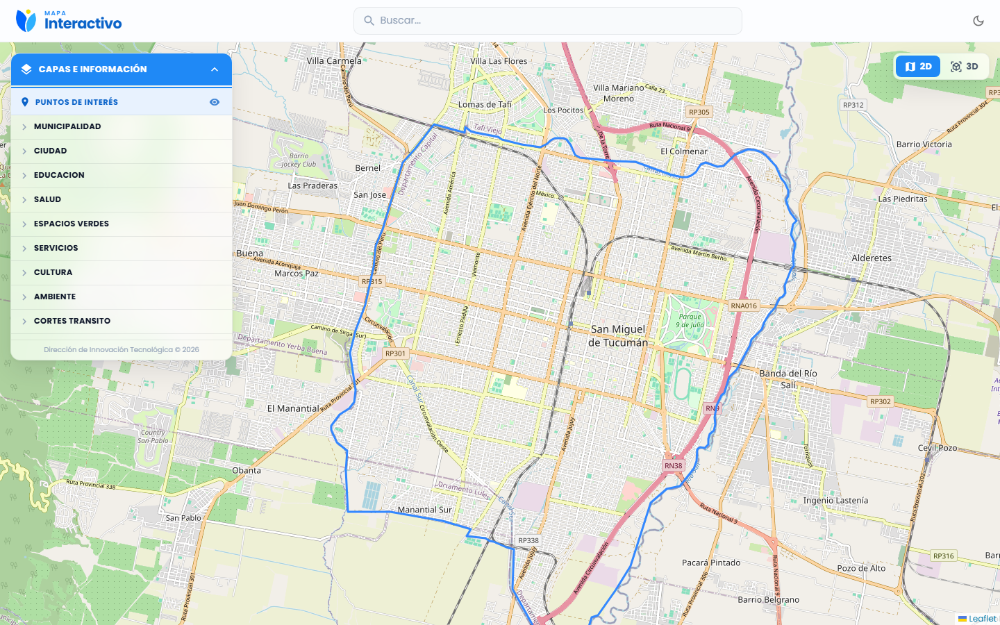

# UX-UI · Diseño "Ciudad Digital" — DITEC

Recursos gráficos, código de referencia y **prompts para Claude** para llevar cualquier frontend de la Municipalidad al mismo diseño que ya tienen **Movilidad Urbana**, **Mapa Interactivo** y **CiDiTuc**.

| Si tu app es… | Usá el estilo | Referencia |
|---|---|---|
| Interna, con login (panel, ABM, tablas, reportes, mapa) | **Ciudad Digital** (`--cd-*`) | Movilidad Urbana, Mapa Interactivo |
| Pública (landing, login, registro) | **CiDiTuc UI** (`--cdt-*`) | ladingPageCidituc |

Más detalle en [guia/cual-estilo-usar.md](guia/cual-estilo-usar.md).



---

## Qué hay en el repo

```
UX-UI/
├─ guia/                 ← el sistema de diseño explicado (colores, tipografía, componentes) + checklist
├─ prompts/              ← paso a paso: un prompt por fase para pegar en Claude Code
├─ skill/                ← skill de Claude Code que hace todo el paso a paso guiado
├─ plantillas/           ← código listo para copiar (tema MUI, CSS, NavBar, menú lateral, alertas…)
├─ recursos/logos/       ← logos oficiales (header, favicon, PDFs, fondos oscuros)
└─ capturas/             ← cómo tiene que quedar
```

---

## Paso a paso (con Claude Code)

### 0. Una sola vez: clonar este repo y (opcional) instalar la skill

Cloná este repo **al lado** de tus proyectos (así los prompts lo encuentran en `../UX-UI`):

```bash
cd "C:/Users/<vos>/Desktop/DITEC CODE"
```

```bash
git clone https://github.com/ditec-desarrollo/ux-ui.git UX-UI
```

Si querés la skill (recomendado), copiala a tu carpeta de skills de Claude:

```bash
cp -r UX-UI/skill/estilo-ciudad-digital ~/.claude/skills/
```

> Si clonaste en otro lado, reemplazá `../UX-UI` por tu ruta en los prompts.

### 1. Abrí Claude Code en la app que querés migrar

Trabajá en una rama nueva (`git checkout -b diseno-ciudad-digital`) y con la app corriendo (`npm run dev`) para ir viendo los cambios.

### 2A. Con la skill (lo más simple)

Escribí en Claude:

```
/estilo-ciudad-digital
```

o simplemente *"pasá esta app al estilo Ciudad Digital como Movilidad"*. La skill hace las fases de abajo en orden y te pide confirmación entre cada una.

### 2B. Sin la skill: prompts uno por uno

Pegá cada prompt en Claude, **en orden**, y revisá la app en el navegador antes de pasar al siguiente. Conviene hacer un commit al terminar cada fase.

| # | Prompt | Qué hace |
|---|---|---|
| 0 | [00-analizar-app.md](prompts/00-analizar-app.md) | Claude analiza la app y te propone un plan. **No toca código.** |
| 1 | [01-base-tema-tokens.md](prompts/01-base-tema-tokens.md) | Poppins, tokens CSS, tema MUI, modo día/noche |
| 2 | [02-navbar-drawer.md](prompts/02-navbar-drawer.md) | Header de vidrio con logo, menú lateral, menú de usuario |
| 3 | [03-paginas-tablas-modales.md](prompts/03-paginas-tablas-modales.md) | Encabezados de página, tablas, modales, cards, formularios |
| 4 | [04-alertas-loaders.md](prompts/04-alertas-loaders.md) | SweetAlert con estilo, skeletons de carga |
| 5 | [05-modo-oscuro-y-revision.md](prompts/05-modo-oscuro-y-revision.md) | Colores sueltos → tokens, modo oscuro, mobile, checklist final |
| + | [extra-paginas-publicas-cidituc.md](prompts/extra-paginas-publicas-cidituc.md) | Solo para landing / login / registro públicos |

### 3. Revisá con el checklist

[guia/checklist-revision.md](guia/checklist-revision.md): modo claro y oscuro, mobile (390 px), impresión, alertas sobre modales, etc.

---

## Reglas rápidas

- **Fuente:** Poppins (300–700).
- **Azul principal:** `#1f89f6` (hover `#0b63c9`). Fondo `#f4f6fb`, texto `#0f172a`.
- **Nunca** colores sueltos en el código: usar `var(--cd-…)` en CSS o `theme.palette` en MUI.
- **Logo del header:** `recursos/logos/logoMuni-sm.png`, 36 px de alto, con dos palabras de marca (`MOVILIDAD` / `Urbana`).
- Alertas siempre con `common/alerta.js`, no importando `sweetalert2` directo.
- Cambios **solo visuales**: no tocar lógica, endpoints ni rutas.

Todo el detalle está en [guia/sistema-de-diseno.md](guia/sistema-de-diseno.md).

---

## Mantener este repo

Si mejorás algo del diseño en una app (p. ej. Movilidad), copiá el archivo actualizado a `plantillas/` y anotá el cambio en el commit. Las versiones de referencia actuales salen de:

- Tema y CSS: `MapaInteractivo/src/theme/*` y `MapaInteractivo/src/styles/ciudadDigital.css`
- NavBar / menú lateral / alertas / esqueletos: `Movilidad-Urbana-Front/src/common/*`
- Estilo público: `ladingPageCidituc/src/styles/cdt-ui.css`

Desarrollado por la Dirección de Innovación Tecnológica — Municipalidad de San Miguel de Tucumán.
