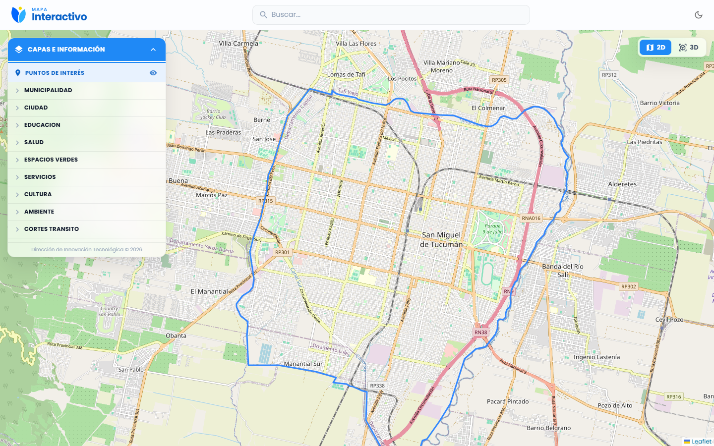
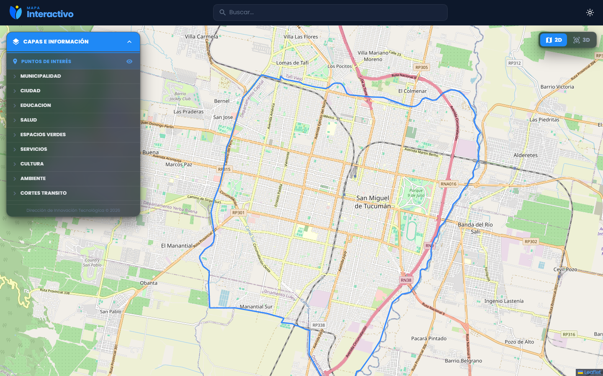
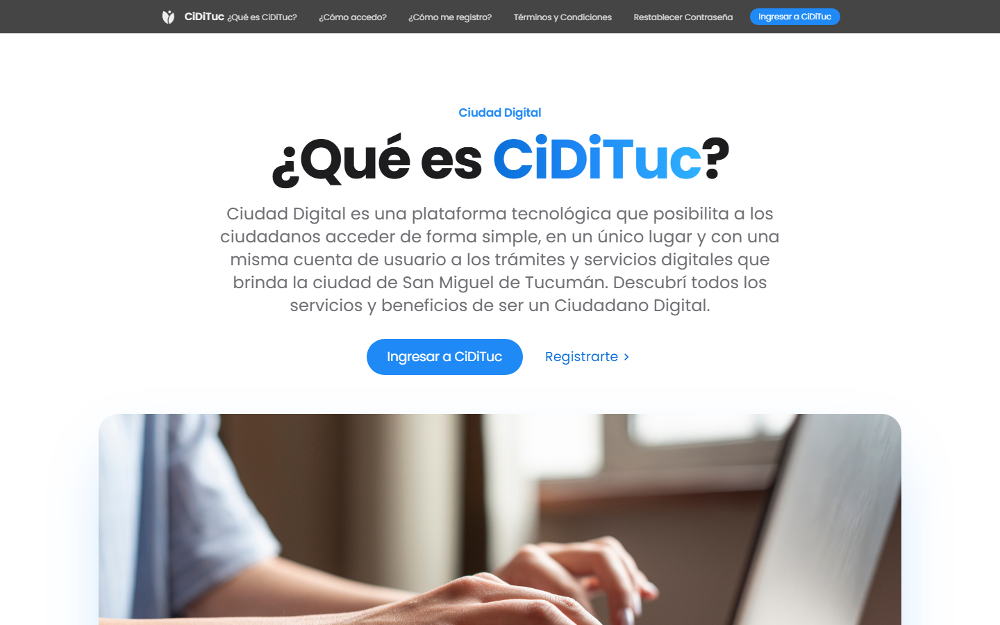
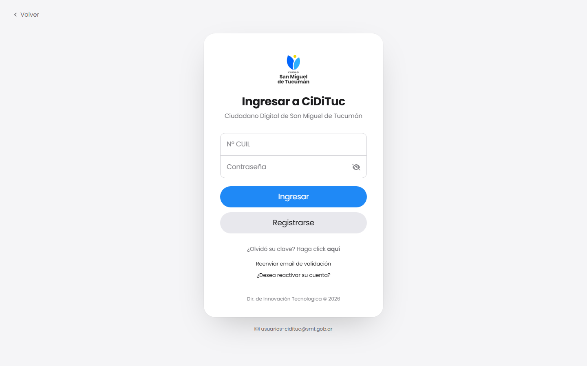

# Capturas de referencia

Muestran cómo tiene que quedar una app migrada. Todas se tomaron a 1440×900.

## Ciudad Digital (apps internas)

| Mapa Interactivo, modo claro | Mapa Interactivo, modo oscuro |
|---|---|
|  |  |

Qué mirar:
- El header de vidrio con el isotipo y las dos palabras de marca (`MAPA` / `Interactivo`).
- El botón de tema a la derecha.
- Los paneles flotantes con radio de 14px y efecto vidrio.
- El azul `#1f89f6` en las cabeceras.

## CiDiTuc UI (pantallas públicas)

| Landing | Login |
|---|---|
|  |  |

## Pendientes

Estas capturas faltan porque **Movilidad Urbana** solo se puede ver con una sesión iniciada en Ciudad Digital:

- `movilidad-home-claro.png` / `movilidad-home-oscuro.png`: home con tarjetas.
- `movilidad-tabla.png`: una pantalla de ABM, con encabezado y tabla.
- `movilidad-menu-lateral.png`: menú lateral abierto.
- `movilidad-modal.png`: modal de alta.
- `*-mobile.png`: las mismas pantallas a 390px de ancho. Sacalas desde DevTools → modo dispositivo, porque Chrome headless no baja de unos 500px.

Si tenés usuario, sacalas y subilas con estos nombres.
